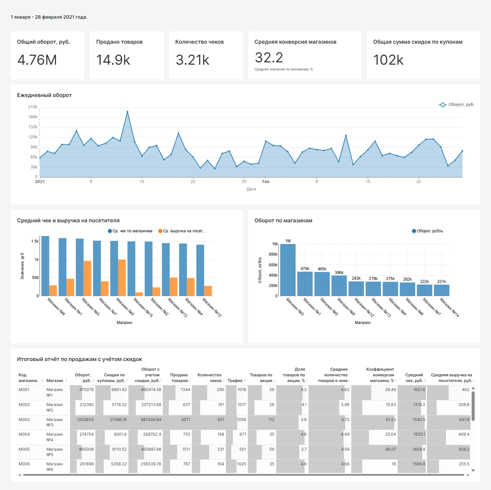

# Retail Sales Data Pipeline

Проект по построению ETL/ELT-пайплайна для аналитики розничных продаж.

## О проекте

Цель проекта - организовать загрузку, обработку и подготовку данных о розничных продажах для последующего анализа.

В проекте используются Greenplum для хранения и обработки данных, Apache Airflow для оркестрации задач, ClickHouse для аналитических запросов и Apache Superset для визуализации результатов.

## Архитектура проекта

```text
Источники данных
       ↓
    Greenplum
       ↓
 Apache Airflow
       ↓
Подготовка витрины продаж
       ↓
    ClickHouse
       ↓
 Apache Superset
       ↓
Аналитический дашборд
```

## Используемые технологии

- **SQL**  извлечение, объединение и агрегация данных.
- **Greenplum**  хранение и обработка данных.
- **Apache Airflow**  оркестрация и последовательный запуск задач загрузки.
- **ClickHouse**  хранение витрины для аналитических запросов.
- **Apache Superset**  визуализация показателей розничной торговли.

## Оркестрация пайплайна в Apache Airflow

Главный DAG std18_266_main_pipeline управляет последовательным выполнением задач загрузки данных и подготовки витрины продаж.
На графе ниже показан успешный запуск пайплайна: все восемь задач завершились со статусом success.

## Реализованные задачи

- Организация загрузки данных из источников в Greenplum.
- Подготовка витрины продаж с бизнес-показателями.
- Настройка последовательного выполнения задач в Apache Airflow.
- Перенос подготовленной витрины в ClickHouse.
- Создание дашборда для анализа розничных продаж.

## Дашборд эффективности розничной торговли в Superset



## Результат

Подготовлена витрина продаж из **804 строк** за период с 1 января по 28 февраля 2021 года.

В дашборде представлены:
- общий оборот;
- количество проданных товаров;
- количество чеков;
- конверсия магазинов;
- скидки по купонам;
- ежедневная динамика оборота;
- сравнение показателей магазинов.

## Что демонстрирует проект

Проект демонстрирует практическую работу с SQL, построение аналитической витрины, оркестрацию загрузки данных и интеграцию аналитических инструментов.

## Статус проекта

В дальнейшем возможны расширение проверок качества данных, автоматизация контроля загрузок и улучшение документации.
